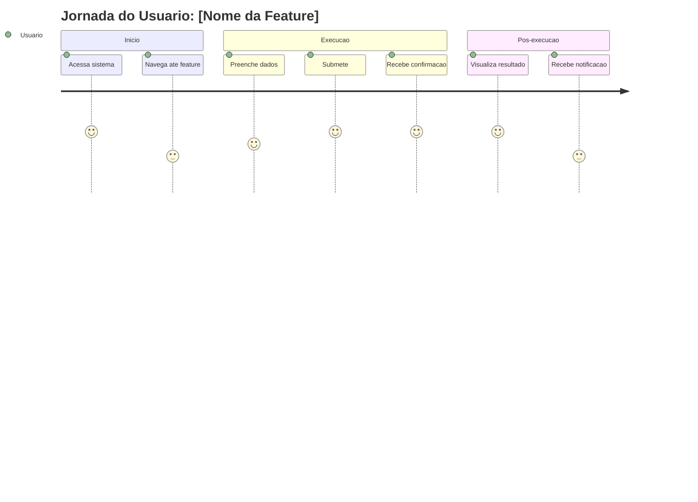

# Template ESPECIFICACAO-FUNCIONAL.md - Requisitos Funcionais

> Copie este arquivo para `docs/ESPECIFICACAO-FUNCIONAL-[FEATURE].md` e preencha.
> Use para documentar requisitos funcionais detalhados antes da implementacao.

---

# Especificacao Funcional: [NOME DA FEATURE]

> Documentacao dos requisitos funcionais para [nome da feature].

---

## 1. CONTEXTO E OBJETIVOS

### Problema
[Descreva o problema que esta feature resolve. Qual a dor do usuario? Qual a oportunidade?]

### Objetivo
[Descreva o objetivo principal em 1 frase mensuravel]

### Objetivos Secundarios
- [Objetivo 1]
- [Objetivo 2]
- [Objetivo 3]

### Metricas de Sucesso (KPIs)
| Metrica | Baseline Atual | Target | Como Medir | Prazo |
|---------|----------------|--------|------------|-------|
| [KPI 1] | [Valor] | [Valor] | [Como] | [Data] |
| [KPI 2] | [Valor] | [Valor] | [Como] | [Data] |

---

## 2. USUARIOS E PERSONAS

### Personas Afetadas
| Persona | Descricao | Necessidades | Prioridade |
|---------|-----------|--------------|------------|
| [Persona 1] | [Descricao] | [Necessidades] | Alta/Media/Baixa |
| [Persona 2] | [Descricao] | [Necessidades] | Alta/Media/Baixa |

### Jornada do Usuario (Happy Path)


### Cenarios Alternativos / Edge Cases
| Cenario | Descricao | Comportamento Esperado |
|---------|-----------|------------------------|
| [Cenario 1] | [Descricao] | [Comportamento] |
| [Cenario 2] | [Descricao] | [Comportamento] |
| [Erro validacao] | [Descricao] | [Mensagem erro clara + recuperacao] |
| [Erro sistema] | [Falha externa/timeout] | [Retry automatico + mensagem amigavel] |
| [Permissao negada] | [Usuario sem permissao] | [403 + mensagem clara + redirect] |

---

## 3. REQUISITOS FUNCIONAIS DETALHADOS

### RF-[NUMERO]: [Nome do Requisito]

**Descricao**: [Descricao detalhada do que o sistema deve fazer]

**Prioridade**: `Obrigatorio` | `Desejavel` | `Opcional` | `Futuro`

**Ator(es)**: [Quem executa: usuario, admin, sistema, API externa]

**Pre-condicoes**: [O que deve ser verdade antes de iniciar]
- [Pre-condicao 1]
- [Pre-condicao 2]

**Pos-condicoes**: [O que deve ser verdade apos execucao bem-sucedida]
- [Pos-condicao 1]
- [Pos-condicao 2]

**Fluxo Principal (Happy Path)**
| Passo | Acao do Usuario | Acao do Sistema | Resultado Esperado |
|-------|-----------------|-----------------|-------------------|
| 1 | [Acao] | [Processamento] | [Resultado] |
| 2 | [Acao] | [Processamento] | [Resultado] |
| 3 | [Acao] | [Processamento] | [Resultado Final] |

**Fluxos Alternativos**
| Codigo | Cenario | Fluxo Alternativo | Resultado |
|--------|---------|-------------------|-----------|
| ALT-01 | [Cenario] | [Passos] | [Resultado] |
| ALT-02 | [Cenario] | [Passos] | [Resultado] |

**Regras de Negocio**
| Regra | Descricao | Validacao |
|-------|-----------|-----------|
| RN-01 | [Regra] | [Como validar] |
| RN-02 | [Regra] | [Como validar] |

**Requisitos de Dados**
| Campo | Tipo | Obrigatorio | Validacao | Exemplo |
|-------|------|-------------|-----------|---------|
| [campo1] | string | Sim | min 2, max 100 | "Joao Silva" |
| [campo2] | email | Sim | formato email | "joao@email.com" |

**Mensagens de Erro**
| Codigo | Situacao | Mensagem Usuario | Log Tecnico |
|--------|----------|------------------|-------------|
| ERR-001 | [Situacao] | "Mensagem amigavel" | [Detalhes tecnicos] |
| ERR-002 | [Situacao] | "Mensagem amigavel" | [Detalhes tecnicos] |

---

## 3. REQUISITOS NAO-FUNCIONAIS

### Performance
| Requisito | Metrica | Target | Como Medir |
|-----------|---------|--------|------------|
| Tempo resposta API | p95 | < 200ms | k6 / APM |
| Tempo carregamento pagina | LCP | < 2.5s | Lighthouse |
| Throughput | req/s | > 100 | Load test |
| Disponibilidade | Uptime | 99.9% | Monitoramento |

### Seguranca
| Requisito | Descricao | Validacao |
|-----------|-----------|-----------|
| Autenticacao | [Obrigatoria/Opcional] | [JWT/Session/MFA] |
| Autorizacao | [Roles/Permissoes] | [RBAC + IDOR check] |
| Validacao entrada | [Zod schemas] | [Testes automatizados] |
| Criptografia | [TLS 1.3 / AES-256] | [Config audit] |
| Logs/Auditoria | [Estruturado/Sanitizado] | [Log review] |

### Acessibilidade (WCAG 2.1 AA)
- [ ] Contraste >= 4.5:1 (texto), 3:1 (large text)
- [ ] Navegacao teclado completa (Tab, Enter, Escape, Setas)
- [ ] Focus visible em todos elementos interativos
- [ ] Labels em inputs (explícitos ou aria-label)
- [ ] Semantic HTML (landmarks, headings hierarchy)
- [ ] Screen reader compatível (NVDA/VoiceOver testado)
- [ ] Contraste UI >= 3:1 (bordas, ícones, focus)

### Usabilidade
- [ ] Feedback visual: loading, error, success, empty states
- [ ] Prevenção erros: confirmacoes acoes destrutivas, validacao tempo real
- [ ] Recuperacao erros: mensagens claras, acoes sugeridas, retry facil
- [ ] Responsividade: 320px, 768px, 1024px, 1440px
- [ ] Touch targets >= 44x44px

### Compatibilidade
| Plataforma | Versao Minima | Testado |
|------------|---------------|---------|
| Chrome | [Versao] | [ ] |
| Firefox | [Versao] | [ ] |
| Safari | [Versao] | [ ] |
| Edge | [Versao] | [ ] |
| Mobile Chrome | [Versao] | [ ] |
| Mobile Safari | [Versao] | [ ] |

---

## 4. INTERFACES E INTEGRACOES

### API Endpoints (Backend)
| Metodo | Endpoint | Request | Response | Auth | AuthZ | Rate Limit |
|--------|----------|---------|----------|------|-------|------------|
| GET | `/api/v1/recursos` | Query params | `PaginatedResponse<RecursoResponse>` | JWT | `recursos:listar` | 100/min |
| POST | `/api/v1/recursos` | `CriarRecursoDTO` | `RecursoResponse` | JWT | `recursos:criar` | 30/min |
| GET | `/api/v1/recursos/:id` | Path params | `RecursoResponse` | JWT | `recursos:ver` | 100/min |
| PATCH | `/api/v1/recursos/:id` | `AtualizarRecursoDTO` | `RecursoResponse` | JWT | `recursos:editar` | 30/min |
| DELETE | `/api/v1/recursos/:id` | - | 204 No Content | JWT | `recursos:excluir` | 10/min |

### Payloads (Exemplos)
```json
// Request: POST /api/v1/recursos
{
  "nome": "Nome do Recurso",
  "descricao": "Descricao opcional",
  "categoriaId": "uuid-da-categoria"
}

// Response: 201 Created
{
  "id": "uuid-gerado",
  "nome": "Nome do Recurso",
  "descricao": "Descricao opcional",
  "categoriaId": "uuid-da-categoria",
  "criadoEm": "2024-01-15T10:30:00Z",
  "atualizadoEm": "2024-01-15T10:30:00Z"
}

// Error: 400 Bad Request
{
  "erro": "VALIDACAO",
  "mensagem": "Dados de entrada invalidos",
  "detalhes": {
    "body.nome": ["Nome deve ter pelo menos 2 caracteres"],
    "body.categoriaId": ["Categoria nao encontrada"]
  }
}
```

### Integracoes Externas
| Sistema | Tipo | Protocolo | Autenticacao | SLA | Contato |
|---------|------|-----------|--------------|-----|---------|
| [Sistema A] | REST API | HTTPS/JSON | Bearer Token | 99.9% | [Contato] |
| [Sistema B] | Webhook | HTTPS/JSON | HMAC Signature | 99.5% | [Contato] |
| [Email Service] | SDK/API | HTTPS | API Key | 99.9% | [Contato] |

### Eventos/Domain Events (se Event-Driven)
| Evento | Publisher | Consumers | Payload | Garantias |
|--------|-----------|-----------|---------|-----------|
| `recurso.criado` | RecursosService | Notificacoes, Analytics | `{ recursoId, usuarioId, timestamp }` | At-least-once |
| `recurso.atualizado` | RecursosService | Auditoria, Cache | `{ recursoId, camposAlterados, usuarioId }` | At-least-once |

---

## 5. REGRAS DE NEGOCIO DETALHADAS

### Regras de Validacao
| Regra | Descricao | Onde Aplicada | Excecoes |
|-------|-----------|-------------|----------|
| RN-001 | [Regra] | [Backend/Frontend/Both] | [Excecoes] |
| RN-002 | [Regra] | [Backend/Frontend/Both] | [Excecoes] |

### Estados e Transicoes (Se State Machine)
| Estado Atual | Evento | Proximo Estado | Acoes | Condicoes |
|--------------|--------|----------------|-------|-----------|
| `rascunho` | `submeter` | `pendente` | Notificar aprovadores | Usuario tem permissao |
| `pendente` | `aprovar` | `aprovado` | Notificar solicitante | Aprovador autorizado |
| `pendente` | `rejeitar` | `rejeitado` | Notificar solicitante com motivo | Aprovador autorizado |
| `aprovado` | `executar` | `concluido` | Processar, notificar | Execucao autorizada |

### Permissoes (RBAC)
| Acao | Roles Permitidas | Condicoes Especiais |
|------|------------------|---------------------|
| `recursos:listar` | `admin`, `manager`, `user` | - |
| `recursos:criar` | `admin`, `manager` | - |
| `recursos:ver` | `admin`, `manager`, `user` | Proprio ou admin |
| `recursos:editar` | `admin`, `manager` | Proprio ou admin |
| `recursos:excluir` | `admin` | - |
| `recursos:aprovar` | `admin`, `manager` | Apenas se `pendente` |

---

## 6. CASOS DE TESTE (Para QA/Automacao)

### Cenarios de Teste por Requisito
| RF | Cenario | Tipo | Prioridade | Pre-condicoes | Passos | Resultado Esperado |
|----|---------|------|------------|---------------|--------|-------------------|
| RF-001 | Happy path | E2E | Critica | Usuario logado, dados validos | 1. Acessa pagina 2. Preenche form 3. Submete | Sucesso, redirect, toast |
| RF-001 | Dados invalidos | Unit/Int | Alta | Usuario logado | 1. Submete form vazio | Erros validacao por campo |
| RF-001 | Duplicado | Int | Media | Registro existente | 1. Tenta criar duplicado | 409 Conflito |
| RF-001 | Sem permissao | E2E | Critica | User sem role | 1. Acessa endpoint | 403 Forbidden |
| RF-001 | IDOR | Int | Critica | User A, recurso User B | 1. Tenta editar User B | 403/404 |

### Cenarios Edge Cases
| Cenario | Descricao | Comportamento Esperado |
|---------|-----------|------------------------|
| Timeout API externa | API demora > 30s | Timeout 30s -> retry 2x -> erro amigavel |
| Rede instavel | Falha intermitente | Retry exponencial (3x) -> fila offline -> sync posterior |
| Concorrencia | 2 users editam mesmo registro | Optimistic locking -> 409 conflite -> merge manual |
| Dados massivos | Import 10k registros | Chunk 500 -> progress bar -> resumivel |
| Acesso offline | Usuario sem internet | Queue local -> sync quando online |

---

## 7. CRITERIOS DE ACEITACAO (Definition of Done)

### Por Requisito Funcional
| RF | Criterio | Como Validar | Status |
|----|----------|--------------|--------|
| RF-001 | [Descricao] | Teste E2E CT-XXX APROVADO | [ ] |
| RF-002 | [Descricao] | Teste Unit CT-YYY + Integracao | [ ] |

### Definition of Done Global
- [ ] Todos RFs implementados e testados
- [ ] Testes: Unit >= 80%, Integracao 100%, E2E criticos 100%
- [ ] Cobertura: Linhas 80%, Branches 70%, Funcoes 80%
- [ ] TypeScript: 0 erros (`tsc --noEmit`)
- [ ] Lint: 0 errors (`npm run lint`)
- [ ] Build: Sucesso (`npm run build`)
- [ ] Seguranca: Auditoria APROVADA, 0 high/critical npm audit
- [ ] Acessibilidade: 0 violations WCAG 2.1 AA
- [ ] Performance: p95 < 200ms, Bundle < 500KB gzipped
- [ ] Documentacao: README, CHANGELOG, ADRs atualizados
- [ ] Deploy Staging validado + PO aprovou
- [ ] Deploy Producao + Rollback testado (< 5 min)

---

## 8. ANEXOS E REFERENCIAS

### Mockups/Prototipos
- [Link Figma/FigJam/Prototipo]
- [Link para telas especificas]

### Documentos Relacionados
| Documento | Link | Versao |
|-----------|-------|--------|
| ADR-XXX: [Titulo] | [Link] | v1.0 |
| ARQUITETURA.md | [Link] | v1.0 |
| SEGURANCA.md | [Link] | v1.0 |
| TESTES.md | [Link] | v1.0 |

### Glossario
| Termo | Definicao |
|-------|-----------|
| [Termo 1] | [Definicao] |
| [Termo 2] | [Definicao] |

---

## 8. APROVACAO

| Papel | Nome | Assinatura | Data |
|-------|------|------------|------|
| Product Owner | | | |
| Tech Lead | | | |
| UX/Design (se aplicavel) | | | |
| Security (se critico) | | | |

---

**Versao**: 1.0 | **Data**: YYYY-MM-DD | **Autor**: [Nome] | **Status**: [Rascunho/Em Revisao/Aprovado]